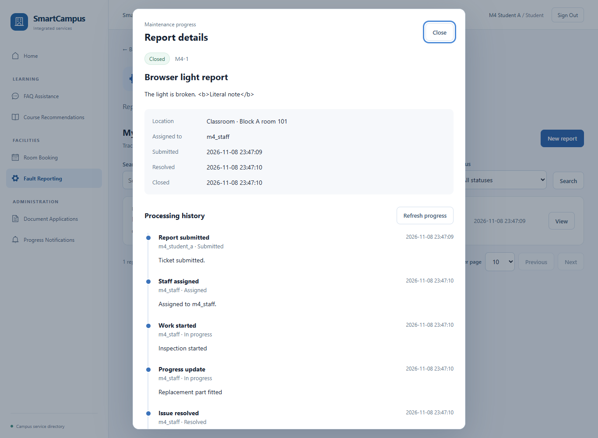
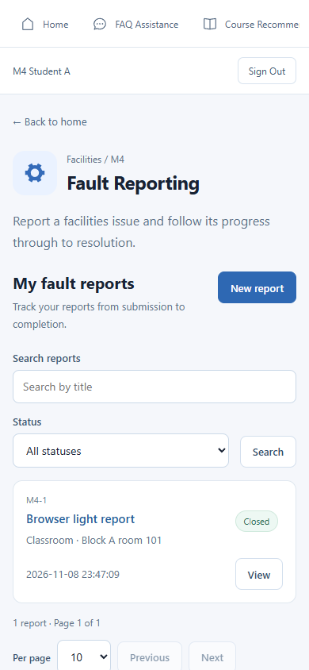
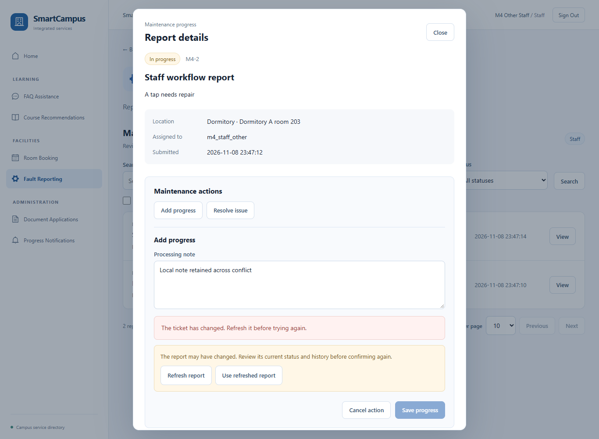
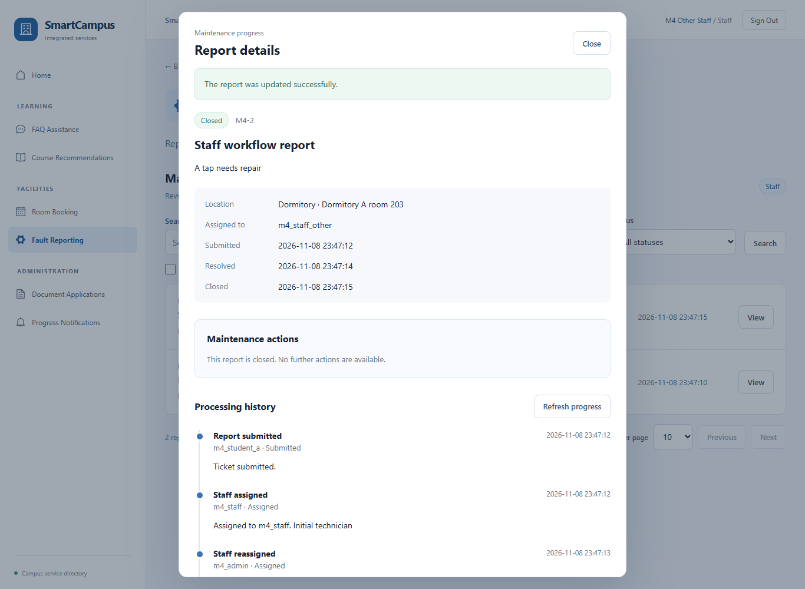
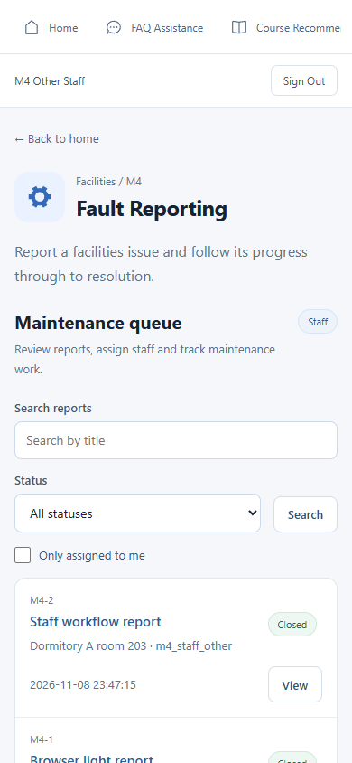

# M4 模块开发与验收记录

验收日期：2026-11-08。模块负责人：Ziming Gong。范围：报修提交、员工分派、状态更新、维修进度和模块验证。

## 四阶段完成情况

| 阶段 | 交付 | 计划占比 | 状态 |
| --- | --- | --- | --- |
| 第一次 | 工单与历史表、Session 身份、创建与查询 | 26% | 完成 |
| 第二次 | 分派、处理状态、历史与并发一致性 | 25% | 完成 |
| 第三次 | 学生表单、本人列表、详情与进度 | 24% | 完成 |
| 第四次 | 员工界面、冲突处理、完整联调与交付 | 25% | 完成 |

完成度为 M4 既定开发范围的 100%，不代表其他模块或 GitHub 发布已完成。

## 功能与验证

| 检查项 | 证据 |
| --- | --- |
| 提交与保存 | 真实浏览器登录、填写表单并提交；MySQL 校验工单与 CREATED 历史 |
| 学生隔离 | 同名、不同账号、大小写账号的接口测试；另一个实际登录学生的越权拒绝 |
| 分派与改派 | 实际 Staff 和 Administrator 页面操作，原负责人失去处理按钮与权限 |
| 状态顺序 | 规则测试、真实 MySQL 与完整浏览器解决/关闭流程 |
| 处理说明 | 进度追加、解决和关闭说明、操作账号与时间线 |
| 事务回滚 | 真实数据库约束故障注入，创建及更新与历史同时回滚 |
| 并发 | 同版本双线程只成功一次；实际浏览器 409 不自动重发 |
| 冲突恢复 | 输入保留，刷新工单与历史，明确确认后才再次写入 |
| 异常与草稿 | 网络失败、重试、会话过期、同账号恢复、异步卸载保护 |
| 页面与安全输出 | 桌面及 390px 手机截图；用户 HTML 内容按文字显示 |
| 持久化 | 停止原 HTTP 服务，新的独立应用实例重新登录后仍读到关闭工单与完整历史 |

## 最终测试结果

- 完整后端及浏览器：29 项通过、0 failure、0 error、0 skipped，详见 springboot/target/m4-final-all.log。
- M4 前端定向检查：26 项通过。包含学生 15 项、员工 10 项和六模块 SSR 1 项。
- 前端构建通过；公共依赖注释和公共包体积有警告，无 M4 编译错误。
- 全量前端：45 项，43 通过、2 个修改前已有失败；缺失英文宿舍演示 SQL 的问题仍需单独处理。
- 可选演示库脚本已在随机改名库验证账号数量和结构，并验证批处理遇错停止；固定演示库未自动创建。

测试是自动化结果，不替代课程老师或组员的最终验收。旧全量测试失败没有删除或跳过。

## 关键截图

以下只含隔离测试库的合成数据。

学生处理时间线：

学生手机列表：

员工冲突处理与输入保留：

员工关闭工单：

员工手机队列：

## 开发记录要点

后端新增独立 M4 表、实体、Mapper、Service、DTO、VO、控制器、Session 解析和状态规则。
前端在既有 Vue 门户中新增学生/员工面板、共用详情、API 与可独立测试的模型；保留原登录和路由。
一致性由 MySQL 事务及按版本、状态、负责人条件的更新保证，处理历史只追加。
第四次复核补齐了提交后异步刷新失效保护，并修正改派后界面提示，提供演示库、运行说明和测试证据。

## 尚需单独安排

原业务库部署、GitHub 提交/推送、全平台其他模块、M6 通知及扩展功能不在本次完成声明内。运行方式见 M4_RUNBOOK.md。
