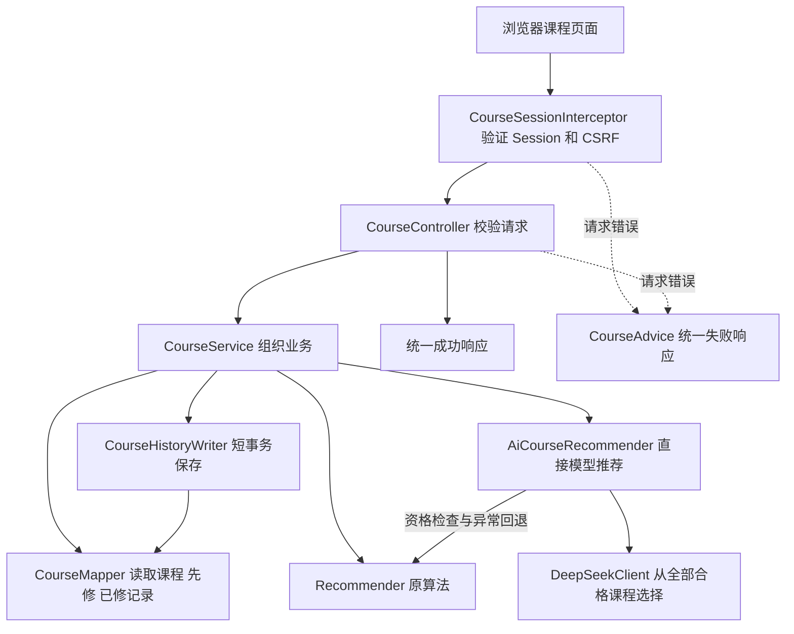

# M2 后端：从请求到推荐结果的阅读入口

完整项目指引统一见 [M2 总入口](../../../../../../../../docs/m2/README.md)。

这里是 M2 课程推荐后端。文档只解释本成员负责的模块及它与公共登录、数据库的连接，不为其他成员编写业务模块说明。

学生输入兴趣与目标，系统读取**服务端保存的已修课程**，检查先修条件，最多给出三门课程。DeepSeek 模式直接读取全部合格课程的摘要并选择、解释；原 Java 算法仍可独立使用，模型异常时明确回退。

## 第一次阅读的顺序

1. [Course](CODE_GUIDE.md#course)、[Recommendation](CODE_GUIDE.md#recommendation)、[RecommendationOutcome](CODE_GUIDE.md#recommendationoutcome)：先了解系统在传递什么数据。
2. [CourseController](CODE_GUIDE.md#coursecontroller) → [CourseService](CODE_GUIDE.md#courseservice)：看一个页面请求如何进入后端。
3. [Recommender](CODE_GUIDE.md#recommender)：看原算法如何检查资格、算分和排序。
4. [AiCourseRecommender](CODE_GUIDE.md#aicourserecommender) → [DeepSeekClient](CODE_GUIDE.md#deepseekclient)：看大模型加在哪两步，哪些事情仍由 Java 决定。
5. [CourseMapper](CODE_GUIDE.md#coursemapper) → [CourseHistoryWriter](CODE_GUIDE.md#coursehistorywriter)：看数据如何读取、保存及回滚。
6. [CourseConfiguration](CODE_GUIDE.md#courseconfiguration)、[CourseSessionInterceptor](CODE_GUIDE.md#coursesessioninterceptor)、[CourseException](CODE_GUIDE.md#courseexception)、[CourseAdvice](CODE_GUIDE.md#courseadvice)：最后检查接入配置、权限与错误分支。

每个 Java 文件有自己的中文类说明和关键方法注释；`CODE_GUIDE.md` 中每个同名章节进一步解释设计意图、调用者、输入输出和修改风险。

## 一次请求的实际调用关系



Mapper 只负责 SQL；Recommender 只负责本地规则和计算；DeepSeekClient 只负责供应商通信。这些职责拆开后，团队可单独修改和测试某一层，避免控制器同时处理身份、SQL、算法和模型调用。

## 14 个源文件与说明一览

| 源文件 | 它解决的问题 | 逐类说明 |
| --- | --- | --- |
| [Course.java](Course.java) | 一门课程包含哪些字段与先修结构 | [阅读](CODE_GUIDE.md#course) |
| [Recommendation.java](Recommendation.java) | 一条结果怎样携带课程、分数和理由 | [阅读](CODE_GUIDE.md#recommendation) |
| [RecommendationOutcome.java](RecommendationOutcome.java) | 页面如何知道实际用了模型还是回退 | [阅读](CODE_GUIDE.md#recommendationoutcome) |
| [CourseController.java](CourseController.java) | 请求格式与各 API 的合同 | [阅读](CODE_GUIDE.md#coursecontroller) |
| [CourseService.java](CourseService.java) | 数据、推荐、历史的组织顺序 | [阅读](CODE_GUIDE.md#courseservice) |
| [Recommender.java](Recommender.java) | 已修 / 先修过滤与 TF-IDF 公式 | [阅读](CODE_GUIDE.md#recommender) |
| [AiCourseRecommender.java](AiCourseRecommender.java) | 模型直接选择合格课程及结果校验、回退 | [阅读](CODE_GUIDE.md#aicourserecommender) |
| [DeepSeekClient.java](DeepSeekClient.java) | 后端密钥、HTTP、JSON、超时和限额 | [阅读](CODE_GUIDE.md#deepseekclient) |
| [CourseHistoryWriter.java](CourseHistoryWriter.java) | 为什么画像和历史要同一个短事务 | [阅读](CODE_GUIDE.md#coursehistorywriter) |
| [CourseMapper.java](mapper/CourseMapper.java) | 哪个方法读写哪张表 | [阅读](CODE_GUIDE.md#coursemapper) |
| [CourseConfiguration.java](CourseConfiguration.java) | 如何把 Mapper 和拦截器注册进应用 | [阅读](CODE_GUIDE.md#courseconfiguration) |
| [CourseSessionInterceptor.java](CourseSessionInterceptor.java) | 为什么接口不能相信前端账号 | [阅读](CODE_GUIDE.md#coursesessioninterceptor) |
| [CourseException.java](CourseException.java) | 预期错误如何携带状态 | [阅读](CODE_GUIDE.md#courseexception) |
| [CourseAdvice.java](CourseAdvice.java) | 错误如何变成统一的 HTTP 响应 | [阅读](CODE_GUIDE.md#courseadvice) |

## 不要混淆的三种信息

- **课程公开资料**：来自课程目录，数据与先修证据由本项目受控导入。
- **学生已修记录**：来自 `m2_completed`；不是兴趣文本中的自我声明，不能由推荐请求覆盖。
- **推荐结果和兴趣画像**：由本次查询生成并保存；历史记录目前不参与模型训练或协同过滤。

更改一个课程字段时，要同时考虑 Mapper 列别名、前端读取字段和已保存的历史 JSON；更改一个接口时，要区分原接口返回数组与辅助接口返回对象的合同。

## 如何检查自己的理解

在项目根目录 `D:\download\883project` 运行：

```powershell
.\tools\m2\maven.ps1 -f springboot/pom.xml "-Dtest=CourseApiTest,DeepSeekRecommendationTest,RecommenderTest" test
```

这组测试使用 MockMvc / 模拟 HTTP 验证输入、权限、算法和模型输出校验，不证明真实供应商已经接通。数据库集成测试用 `MySqlCourseTest`，需要按 [运行说明](../../../../../../../../docs/m2/README.md) 配置隔离演示 MySQL；不要为了测试初始化或覆盖团队库。

继续阅读：[DeepSeek 配置与验证边界](../../../../../../../../docs/m2/README.md) · [M2 后端 AGENTIC](AGENTIC.md)。
